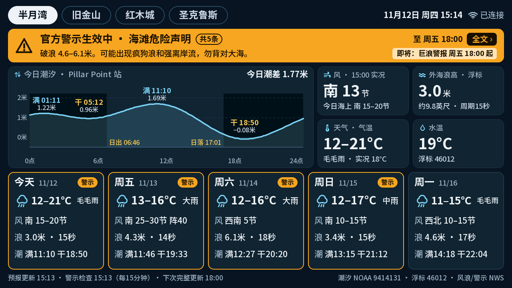
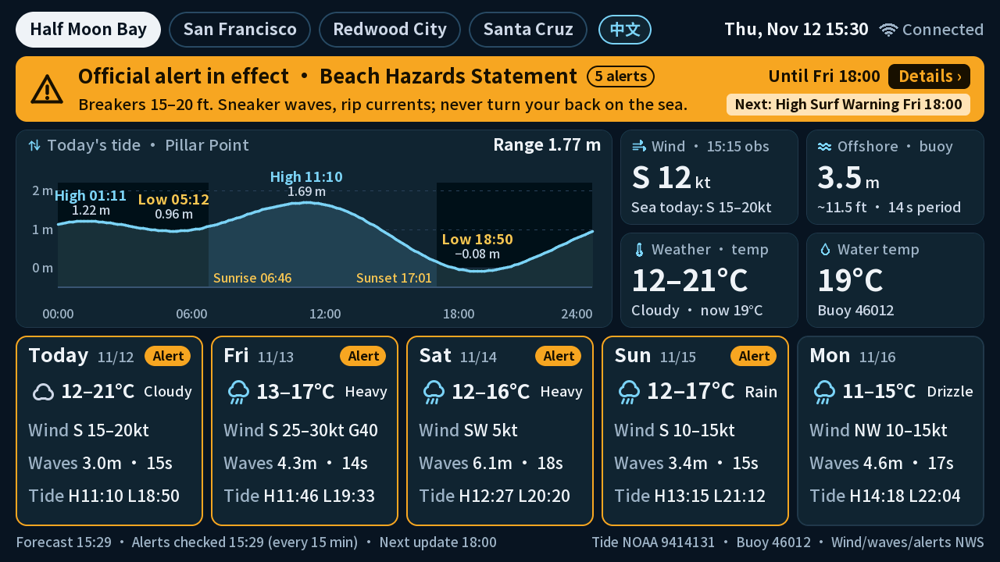
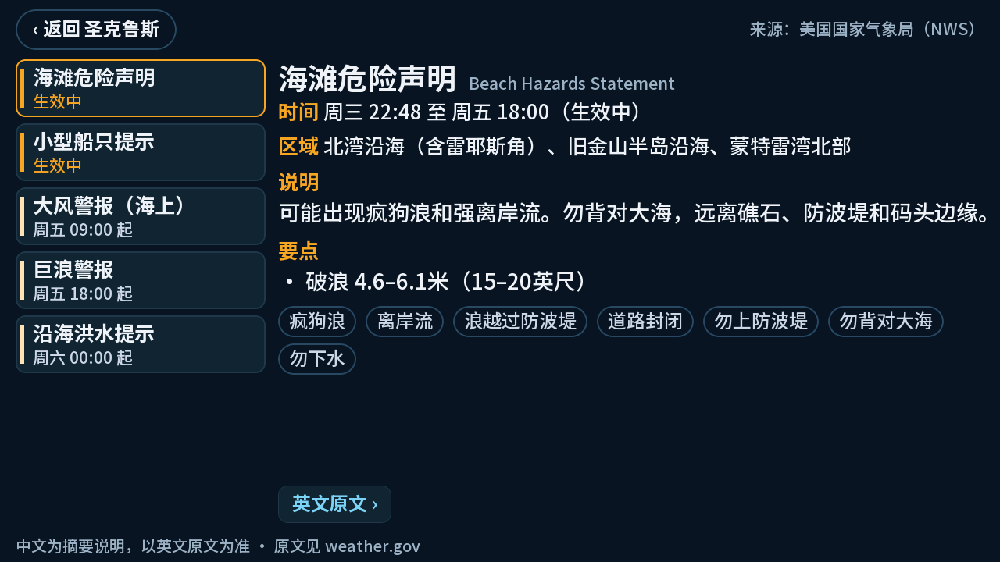

# bay-fish-forecast · 钓鱼海况屏

An always-on fishing-conditions display for the **M5Stack Tab5**. For four SF Bay Area spots it shows the
**official NWS hazard alerts**, today's **tide curve**, current conditions and a **5-day outlook**, in **Simplified Chinese**
with a one-tap **English** option. It runs entirely on the device: no server, no API keys, no paid services.

| 中文 (default) | English |
|---|---|
|  |  |

Tap the alert banner for the details: a Chinese summary, extracted facts, keyword tags and the full English NWS text.



## Why I built this

My dad is an avid angler in the SF Bay Area. Planning a trip means checking several places: tide tables, the marine
forecast, the weather, and the National Weather Service for warnings. Most of it is in English, and the most important
piece, a Beach Hazards Statement or High Surf Warning about sneaker waves and rip currents, is the easiest to miss.

So I built him one screen. It sits at home where he can glance at it the night before or the morning of a trip. Official
alerts come first, in Chinese, followed by the tide, wind, waves and water temperature for the spots he fishes. It never
says "safe". It shows what the NWS has issued and when it last checked, and the call stays with him.

If someone in your life fishes the Bay, I hope it helps them plan safely too.

## Features

- **Official alerts first.** Beach Hazards Statements, High Surf, Small Craft, Gale, Coastal Flood, Tsunami… from the NWS API,
  with a three-state banner: *alert issued* / *no alert found as of HH:mm* / *status unknown*. It never says "safe".
  Upcoming alerts are shown too ("即将：巨浪警报 周五 18:00 起" / "Next: High Surf Warning Fri 18:00").
- **Tide chart** for today from NOAA high/low predictions (cosine-interpolated), with sunrise/sunset shading and the daily range.
- **Wind and seas from the official NWS marine zone forecast** (e.g. `南 25–30节 阵40` / `S 25–30kt G40`), plus buoy observations,
  water temperature and weather.
- **5-day cards** with alert tags, wind, waves (or tidal range for bay spots) and tide times.
- Refreshes the forecast 3×/day and checks alerts every 15 min. Works offline from cache; tides stay correct for days.
- **On-device Wi-Fi setup** (touch keyboard), NTP + RTC clock, over-the-air updates, USB serial diagnostics.

## Locations

| Tab | Profile | NWS zone / marine zone | Tide station (NOAA) | Buoy / water temp |
|---|---|---|---|---|
| 半月湾 Half Moon Bay | coastal | CAZ509 / PZZ545 | 9414131 Pillar Point Harbor | NDBC 46012 |
| 旧金山 San Francisco | coastal | CAZ006 / PZZ545 | 9414290 San Francisco | NDBC 46026 |
| 红木城 Redwood City | bay | CAZ508 / PZZ531 | 9414523 Redwood City | CO-OPS 9414750 Alameda |
| 圣克鲁斯 Santa Cruz | coastal | CAZ529 / PZZ535 | 9413745 Santa Cruz | NDBC 46236 |

Adding a spot is one row in `lib/core/places.cpp` (check the IDs against the APIs first; see `docs/PRD.md` §4).

## Data sources

| Data | Source |
|---|---|
| Hazard alerts, marine zone forecasts | [National Weather Service API](https://www.weather.gov/documentation/services-web-api) |
| Tide predictions, bay water temperature | [NOAA CO-OPS](https://api.tidesandcurrents.noaa.gov/api/prod/) |
| Buoy observations | [NOAA NDBC](https://www.ndbc.noaa.gov/) |
| Weather, temperature, model waves | [Open-Meteo](https://open-meteo.com/) ([CC BY 4.0](https://open-meteo.com/en/license); weather data by Open-Meteo.com) |

> **Not an official safety product.** This display summarizes public data and can be wrong or out of date.
> Always check [weather.gov](https://www.weather.gov/mtr/) or NOAA Weather Radio before going out on the water.

## Hardware

M5Stack **Tab5** (ESP32-P4 + ESP32-C6 Wi-Fi, 5" 1280×720). Tested on the ST7121/ST7123 display revision.

## Build and flash

```sh
# PlatformIO in a Python 3.10–3.14 venv (the pioarduino platform rejects newer Python)
python3 -m venv ~/.pio-venv && ~/.pio-venv/bin/pip install platformio pyserial

# Fonts: download Noto Sans SC (OFL) from github.com/google/fonts (ofl/notosanssc/NotoSansSC[wght].ttf)
#        to tools/fonts-src/NotoSansSC-VF.ttf, then generate the subset VLW fonts:
python3 tools/make_fonts.py                       # -> data/fonts/*.vlw (not committed)

cp include/secrets.example.h include/secrets.h     # set OTA_PASSWORD (8+ chars) to enable Wi-Fi updates

~/.pio-venv/bin/pio test -e native                 # core logic tests on your computer
~/.pio-venv/bin/pio run -e board_Tab5 -t uploadfs  # fonts -> LittleFS (USB)
~/.pio-venv/bin/pio run -e board_Tab5 -t upload    # firmware (USB)
```

Make a full backup of the factory firmware before the first flash:
`esptool --chip esp32p4 -p <port> -b 921600 read-flash 0 0x1000000 tab5-factory.bin`.

**Wi-Fi:** on first boot the Tab5 shows nearby networks; tap one and type the password on the touch keyboard
(or `tools/tab5 wifi_set "<ssid>" "<password>"` over USB). It must be a 2.4 GHz network.

**Updates over Wi-Fi:** `~/.pio-venv/bin/pio run -e ota -t upload --upload-port <tab5-ip>`. The password comes from
`OTA_PASSWORD` in `include/secrets.h` or `$BAY_FISH_OTA_PASSWORD`; OTA is disabled when none is set.

**Using it:** tap a tab to switch spots, tap the banner for alert details, tap `EN`/`中文` to switch the language,
long-press the date to refresh now, long-press the Wi-Fi status for Wi-Fi settings.

## Diagnostics and accuracy audit

```sh
tools/tab5 status | report | fetch | alerts | shot out.png | tap X Y [hold] | debug on|off | reboot | listen [s]
python3 tools/audit.py   # device on USB: recompute every displayed field from live sources and compare
```

## Project layout

```
lib/core/   portable C++ (no Arduino): parsers, alert pipeline, alert-text facts, NWS marine parsing, tide model,
            Chinese/English formatting, buildReport()
src/        device: Wi-Fi + fetch schedule + OTA (net), LittleFS cache (store), RTC/NTP (clock), screens (ui), fonts, serial
test/       native unit tests against fixtures/ (real API responses captured 2026-11-11/12)
tools/      font generator, serial helper, accuracy audit, OTA password helper
docs/       PRD.md (full requirements and decisions), prototype scripts, screenshots
```

Design notes worth knowing: `std::regex` recurses per character and overflows small task stacks, so long NWS text is parsed
by hand; NDBC `latest_obs` files change shape between reports (key-based parser, GMT time line); Open-Meteo can serve two
model runs from different servers for a while after an update. See `docs/PRD.md` for everything else.

## License

[MIT](LICENSE). Third-party parts keep their own licenses: Noto Sans SC (SIL OFL 1.1, downloaded at build time, not
included), M5Unified/M5GFX (MIT), ArduinoJson (MIT). Data: NWS/NOAA (US public domain), Open-Meteo (CC BY 4.0).
